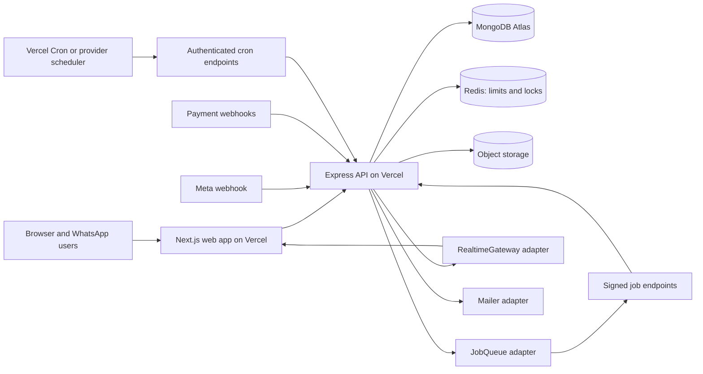
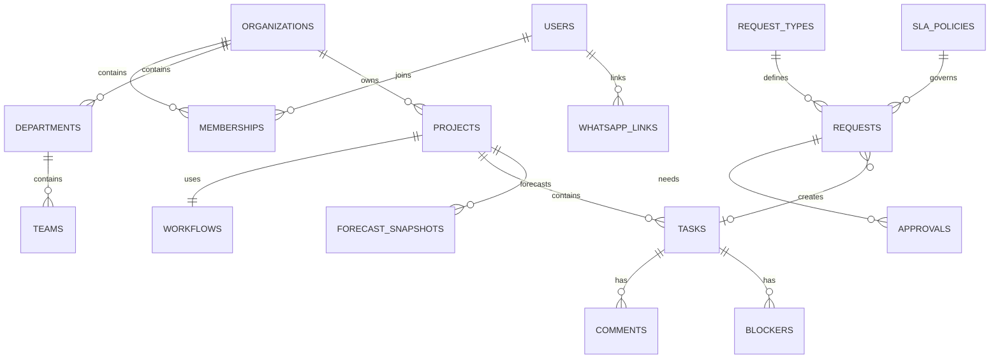

# Kaaryasthan architecture

Status: foundation design. The product spec calls this product TaskFlow; Kaaryasthan is the repository and product name used in new code. This document describes intended modules, not implemented features. See `MASTER-PROMPT.md` for feature detail and `API.md` for the proposed HTTP surface.

## System

The same Git repository deploys as two Vercel projects: `apps/web` and `apps/api`. `packages/shared` holds Zod contracts, permissions, constants, and deterministic forecasting and SLA math. The API separates routes, controllers, services, tenant-scoped repositories, and MongoDB models. Provider SDK calls stay behind adapters.

## Tenancy and authorization

`users` are global identities. `organizations` are tenants; `memberships` connect users to organizations and roles. Every other tenant-owned collection includes an immutable `organizationId`. The API derives it from the authenticated session and adds it inside the repository layer. Requests cannot select a tenant by passing an arbitrary body or query value. A membership can select the active organization only after server-side verification. All tenant indexes begin with `organizationId`.

Project visibility and project membership add a second scope. API permission checks are authoritative. Cross-tenant reads return no document; writes are rejected. Unique constraints that are tenant-specific include `organizationId`. Every endpoint introduced after Phase 4 needs success, validation, forbidden, and cross-tenant tests.

## Collection model

The fields below are the minimum identity and relationship fields. All documents also have `_id`, `createdAt`, and `updatedAt`. Tenant-owned collections have `organizationId` unless listed as global. Soft-deletable records have `deletedAt`, excluded by default. Migrations or index scripts create the indexes; request handlers do not.

| Collection                                               | Key fields                                                                                 | Planned indexes                                                                                                                  |
| -------------------------------------------------------- | ------------------------------------------------------------------------------------------ | -------------------------------------------------------------------------------------------------------------------------------- |
| `users` (global)                                         | email, passwordHash, verifiedAt, profile                                                   | unique normalized email                                                                                                          |
| `organizations` (global root)                            | slug, name, planId                                                                         | unique slug                                                                                                                      |
| `memberships`                                            | userId, role, status, joinedAt                                                             | unique `(organizationId,userId)`; `(userId,status)`                                                                              |
| `departments`, `teams`                                   | name, parent departmentId, leadId                                                          | `(organizationId,name)`; `(organizationId,departmentId)`                                                                         |
| `projects`                                               | key, name, visibility, status, ownerId                                                     | unique `(organizationId,key)`; `(organizationId,status,updatedAt)`                                                               |
| `workflows`                                              | projectId, statuses, transitions, version                                                  | unique `(organizationId,projectId)`                                                                                              |
| `sprints`, `milestones`                                  | projectId, name, startAt, dueAt                                                            | `(organizationId,projectId,dueAt)`                                                                                               |
| `tasks`                                                  | projectId, workflowStatusId, assigneeIds, reporterId, parentTaskId, dueAt, rank, deletedAt | `(organizationId,projectId,workflowStatusId,rank)`; `(organizationId,assigneeIds,dueAt)`; `(organizationId,projectId,updatedAt)` |
| `comments`, `attachments`, `timeEntries`                 | taskId, authorId/userId, storageKey or duration                                            | `(organizationId,taskId,createdAt)`                                                                                              |
| `activityLogs`, `auditLogs`                              | actorId, subjectType, subjectId, event, timestamp                                          | `(organizationId,subjectType,subjectId,createdAt)`; `(organizationId,createdAt)`                                                 |
| `notifications`, `notificationPreferences`               | recipientId, eventId, readAt/channels                                                      | `(organizationId,recipientId,readAt,createdAt)`; unique `(organizationId,recipientId)`                                           |
| `savedFilters`, `customFieldDefinitions`                 | ownerId/projectId, name, definition                                                        | `(organizationId,ownerId)`; `(organizationId,projectId,name)`                                                                    |
| `blockers`, `escalationPolicies`                         | taskId, waitingOn, since, expectedAt, status, firedSteps                                   | `(organizationId,status,expectedAt)`; `(organizationId,waitingOn,status)`; `(organizationId,taskId,status)`                      |
| `requestTypes`, `requests`                               | formSchema/routing; typeId, requesterId, assigneeId, taskId, status, slaState              | `(organizationId,status,updatedAt)`; `(organizationId,requesterId,createdAt)`; `(organizationId,assigneeId,status)`              |
| `approvals`                                              | requestId, approverId, step, status, delegatedTo                                           | `(organizationId,approverId,status)`; unique `(organizationId,requestId,step,approverId)`                                        |
| `slaPolicies`, `businessCalendars`                       | target minutes, timezone, holidays, working hours                                          | `(organizationId,requestTypeId)`; `(organizationId,timezone)`                                                                    |
| `forecastSnapshots`                                      | projectId, scope, seed, percentiles, confidence, runId                                     | `(organizationId,projectId,createdAt)`; unique `(organizationId,runId)`                                                          |
| `automationRules`, `webhooks`, `apiKeys`, `integrations` | trigger/endpoint/hash/config, status                                                       | `(organizationId,status)`; unique `(organizationId,keyHash)` where applicable                                                    |
| `whatsappLinks`, `whatsappMessages`                      | userId, phoneHash, optInAt; providerMessageId, direction, status                           | unique `(organizationId,userId)`; unique `(organizationId,providerMessageId)`                                                    |
| `plans` (global), `subscriptions`, `usageCounters`       | limits; providerId/status; period/metric/count                                             | unique plan key; unique `(organizationId,period,metric)`                                                                         |

Task dependencies need a separate edge collection with unique `(organizationId,blockingTaskId,blockedTaskId)` and indexes in both directions. `jobReceipts` and `webhookReceipts` need unique provider IDs or idempotency keys to prevent duplicate side effects. Index choices must be checked against actual query plans as each module is built.

## Roles and permissions

The role matrix is an initial default, implemented as named permissions in `packages/shared` in Phase 4. A tenant owner can grant narrower project access. Guest or client access is limited to explicitly shared projects or requests.

| Capability                                | Owner       | Admin       | Manager           | Team Lead     | Member            | Guest/Client      |
| ----------------------------------------- | ----------- | ----------- | ----------------- | ------------- | ----------------- | ----------------- |
| Manage organization, billing, and members | Yes         | Members     | No                | No            | No                | No                |
| Manage departments and teams              | Yes         | Yes         | Assigned          | Assigned team | No                | No                |
| Create and configure projects/workflows   | Yes         | Yes         | Assigned          | Assigned      | No                | No                |
| Create and edit tasks                     | Yes         | Yes         | Assigned projects | Assigned team | Assigned projects | Shared items only |
| Approve requests                          | If assigned | If assigned | If assigned       | If assigned   | If assigned       | No                |
| View reports and forecasts                | Yes         | Yes         | Assigned          | Assigned team | Limited           | No                |
| Configure SLA, automations, WhatsApp      | Yes         | Yes         | Assigned modules  | No            | No                | No                |
| Read audit logs and API keys              | Yes         | Yes         | No                | No            | No                | No                |

Every permission is evaluated against the active organization plus resource scope. `Assigned` never grants access to another tenant.

## Events

Events have `eventId`, `organizationId`, actor, subject, timestamp, and schema version. Durable events are recorded before retries or external delivery. Consumers use `eventId` as an idempotency key.

| Event family | Examples                                                                                   | Consumers                                   |
| ------------ | ------------------------------------------------------------------------------------------ | ------------------------------------------- |
| Membership   | `member.invited`, `member.deactivated`                                                     | email, audit                                |
| Project/task | `project.created`, `task.created`, `task.moved`, `task.completed`, `comment.added`         | realtime, notifications, webhooks, activity |
| Blocker      | `blocker.raised`, `blocker.escalated`, `blocker.resolved`                                  | notifications, stalled view, audit          |
| Request/SLA  | `request.submitted`, `request.assigned`, `approval.decided`, `sla.warning`, `sla.breached` | notifications, realtime, webhooks           |
| Forecast     | `forecast.requested`, `forecast.completed`, `forecast.failed`                              | realtime, notifications                     |
| WhatsApp     | `whatsapp.linked`, `whatsapp.message.received`, `whatsapp.delivery.failed`                 | queue, audit with no message body           |
| Billing      | `subscription.changed`, `usage.limit_reached`                                              | entitlement cache, notifications, audit     |

## Serverless execution map

| Feature                    | Request path                               | Background/scheduled work                       | Realtime/storage                           |
| -------------------------- | ------------------------------------------ | ----------------------------------------------- | ------------------------------------------ |
| Auth and tenant operations | Short API handlers, DB transactions        | Expiry cleanup via bounded cron                 | Email via Mailer job                       |
| Projects and tasks         | Tenant-scoped CRUD, cursor lists           | Recurrence and digest jobs                      | RealtimeGateway; direct attachment uploads |
| Blockers                   | Raise/resolve in API                       | Due escalation scan and idempotent delayed jobs | Board and stalled-work events              |
| Request desk               | Submit, route, approve in API              | SLA warning/breach scans, CSAT jobs             | Status events; direct attachments          |
| Forecasting                | Enqueue request, read snapshots            | Chunked deterministic simulations               | Completion event and chart data            |
| WhatsApp                   | Verify signed webhook and acknowledge fast | Deduplicated command and outbound jobs          | Provider message IDs; no raw body logs     |
| Reporting/export           | Query paginated summaries                  | Chunked export jobs                             | Download from object storage               |
| Billing/integrations       | Signed webhooks, short API handlers        | Idempotent processing and retries               | Entitlement events                         |

No Vercel function relies on a resident worker, local persistent disk, or shared in-memory state. MongoDB connections may be cached per function instance, but data correctness lives in MongoDB or Redis. Cron endpoints require `CRON_SECRET`; provider jobs and webhooks verify their own signatures.

## Environment and external resources

| Vercel project | Required when feature lands                                                    | Purpose                                         |
| -------------- | ------------------------------------------------------------------------------ | ----------------------------------------------- |
| API            | `NODE_ENV`, `MONGODB_URI`, `WEB_ORIGIN`, `COOKIE_DOMAIN`                       | Runtime, Atlas, browser origin, cookies         |
| API            | `JWT_ACCESS_SECRET`, `JWT_REFRESH_SECRET`, `CRON_SECRET`, `JOB_SIGNING_SECRET` | Auth and internal endpoint signatures           |
| API            | `REDIS_URL`, `QUEUE_PROVIDER_*`, `REALTIME_PROVIDER_*`, `STORAGE_*`, `MAIL_*`  | Rate limits, jobs, events, uploads, email       |
| API            | `WHATSAPP_APP_SECRET`, `WHATSAPP_VERIFY_TOKEN`, `WHATSAPP_ACCESS_TOKEN`        | Meta webhook and API                            |
| API            | `STRIPE_*`, `RAZORPAY_*`, `SENTRY_DSN`                                         | Payments and telemetry                          |
| Web            | `API_URL`, public realtime key, public telemetry DSN                           | Server API access and browser-safe integrations |

Use separate development/preview and production Atlas databases, credentials, Vercel environments, and provider keys. Only browser-safe values receive a `NEXT_PUBLIC_` prefix. Atlas credentials are never placed in the web project. The initial repo does not contain any real secrets.

## Phased risks

| Phase | Risk                                                                   | Mitigation                                                                                |
| ----- | ---------------------------------------------------------------------- | ----------------------------------------------------------------------------------------- |
| 1–2   | Monorepo deployment or database connection fails in serverless runtime | Deploy health route to preview early; verify connection pooling and shared package access |
| 3–4   | Cookie and cross-tenant security errors                                | Session rotation, CSRF checks, exhaustive tenant isolation tests                          |
| 5–7   | Concurrent board writes or duplicate jobs                              | Fractional ranking strategy, optimistic rollback, durable idempotency receipts            |
| 8–9   | SLA and escalation errors around timezones and holidays                | Pure clock-driven functions and fixed-time tests                                          |
| 10    | Forecasts imply false precision                                        | Seeded runs, low-history label, visible risk drivers                                      |
| 11    | WhatsApp policy, opt-in, and delivery failures                         | Verify current Meta policies before launch; consent and retry tests                       |
| 12–14 | Dense UI loses keyboard and mobile usability                           | Accessibility and responsive checks on each feature                                       |
| 15–18 | Export, billing, and launch operations exceed function limits          | Bounded jobs, signed webhooks, backups, restore drills, load tests                        |

## Open decisions

- Select an Atlas region near the Vercel API region and users.
- Choose queue, realtime, object storage, mail, and payment providers when those phases begin.
- Decide whether the final public brand is Kaaryasthan or TaskFlow; code currently uses Kaaryasthan.
