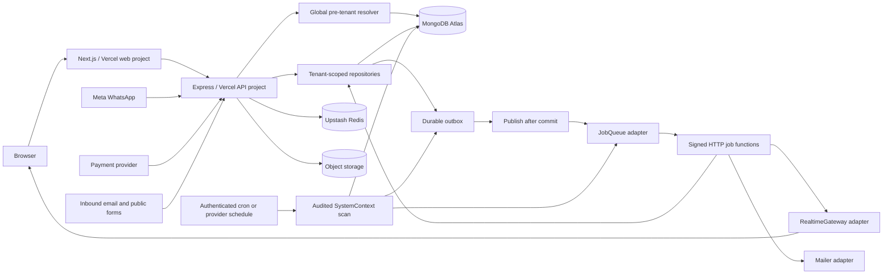

# MyDear Kaaryasthan architecture

Status: Phase 0 design. The repo already has a Phase 1 foundation and part of Phase 2; diagrams here describe planned behavior unless marked live. MyDear Kaaryasthan is the public brand, Kaaryasthan the short UI name, and TaskFlow the working name in the master prompt.

## System

The same Git repo deploys as separate Vercel projects rooted at apps/web and apps/api. packages/shared owns Zod contracts, permission keys, and pure SLA and forecast math. API modules follow routes → controllers → services → repositories → Mongoose models. Provider SDKs stay inside adapters.

## Tenant and authorization boundary

- Users, sessions, refreshTokens, oauthIdentities, authTokens, authAuditLogs, plans, organizations, and lookupRoutes are global or pre-tenant. Tenant documents carry immutable organizationId. Normal repositories inject it and, for soft-deletable collections, the default `{ deletedAt: { $type: "null" } }` filter matching partial unique indexes. A client-provided organizationId never authorizes a query.
- The API verifies active membership, named permission, resource scope, and project visibility or explicit share for every operation. A global resolver supplies only a candidate organization; it grants no access. Cross-tenant reads reveal no document.
- Project roles come from `projectMembers`, request handling from `requestQueues`, and task labels from `labels`; each remains organization-scoped. Private-project access outside membership requires `projects.admin_override` with a reason, audit event, and notification to project members. Permission matrix keys must exactly match `packages/shared` constants, verified by a future automated test.
- Ordinary tenant query indexes start with organizationId. The only global exceptions are named pre-tenant indexes and partial nextCheckAt indexes used by audited system scans. Each scan returns bounded (organizationId, recordId) candidates, atomically claims them with `claimedUntil`/`claimedBy`, and re-enters a tenant repository before mutation.
- Shared Zod schemas validate body, params, query, and API responses. Public routes are under /api/v1 with { data, meta, error } except the raw OpenAPI document, cursor pagination, stable error codes, and request IDs. See DATA-MODEL.md and PERMISSIONS.md.

## Pre-tenant lookups

A restricted global resolver handles a refresh token through global `refreshTokens` and its `sessions.activeOrganizationId`, an opaque invitation/API-key prefix, a verified WhatsApp business phone number ID and sender phone HMAC, a verified billing customer ID, an inbound email destination, or a public form host and slug. It uses purpose-separated HMAC lookup fields for sensitive values and encrypted fields for authorized display; full tokens are compared in constant time after routing. Refresh of a used token within 10 seconds returns retryable `409 REFRESH_RETRY`; later reuse revokes the family and session. This lookup is unavailable as a general query API.

One high-entropy master secret per `keyVersion` is held server-side. HKDF derives separate keys for global and tenant lookup HMACs, refresh and other token HMACs, and field encryption, using purpose labels and environment context. Every protected row stores `keyVersion` for rotation. Opaque bearer tokens have at least 256 bits of CSPRNG entropy; routing prefixes contain at least 96 bits of independently generated entropy. The prefix never authenticates a request.

One staff phone may link to several organizations. A dedicated WhatsApp business number maps to one organization; a shared number or ambiguous sender requires an explicit signed organization choice and a fresh permission check. No “first match” routing. See DATA-MODEL.md for lookup indexes and the multi-org rule.

## System work and reliability

- Business writes and outbox event insertion share a transaction where possible. An immediate publisher runs **after commit** and enqueues delivery; an authenticated bounded cron scan recovers unpublished outbox rows. Idempotency receipts and event IDs protect retries and replays.
- Only verified scheduler or signed job infrastructure creates SystemContext with systemRunId, reason, allowed collection, batch cap, and time window. The system repository records each cross-tenant scan in global systemAuditLogs; mutations also create tenant audit records. User routes, API keys, and custom roles cannot create this context.
- Every system-scanned row stores `claimedUntil` and `claimedBy`; an atomic compare-and-set lease limits duplicate claims, and handlers remain idempotent. Atlas dev index migrations backfill explicit `deletedAt: null`, create each active-row partial unique index with `{ deletedAt: { $type: "null" } }`, inspect `getIndexes()`, and use `explain("executionStats")` plus duplicate/reuse checks before rollout. See DATA-MODEL.md.
- No resident workers, local persistent files, or warm-instance correctness state. MongoDB connections may be cached per function instance with small pools. Redis holds rate limits and measured cache/locks; MongoDB remains the durable source. Uploads go directly to object storage. Forecasts and exports use chunked jobs. External webhooks verify signatures and acknowledge quickly.
- Phase 2 API integration tests use `MongoMemoryReplSet` pinned to MongoDB Community 8.0.38 for real readiness and connection-reuse checks. Atlas dev is 8.0.39; its major version matches, while a Windows Community 8.0.39 archive was unavailable during setup. The binary cache is under the D: workspace's ignored `node_modules/.cache` directory. The harness rejects inherited real MongoDB URIs before test imports and clears external-service variables in workers. Later tenant, transaction, system-context, and idempotency tests will use the same replica set. Pure SLA and forecast tests will use fixed clocks and seeds.

## Environment boundaries

| Project | Stage              | Environment variable names or groups                                                                                                                                                                  |
| ------- | ------------------ | ----------------------------------------------------------------------------------------------------------------------------------------------------------------------------------------------------- |
| API     | Current foundation | MONGODB_URI, MONGODB_DB_NAME, WEB_ORIGIN, KV_REST_API_URL, KV_REST_API_TOKEN                                                                                                                          |
| API     | Phase 3a auth      | COOKIE_DOMAIN, KEY_MASTER_V1 (and later versions), AUTH_ACTIVE_KEY_VERSION, JWT_ISSUER, JWT_AUDIENCE, session lifetime and auth rate settings, MAIL_PROVIDER, MAIL_API_KEY, MAIL_FROM, WEB_PUBLIC_URL |
| API     | Later adapters     | Queue, realtime, storage, mail, WhatsApp, Stripe, Razorpay, and error-tracking credentials, each with provider-specific names                                                                         |
| Web     | Current and later  | NEXT_PUBLIC_API_URL and browser-safe public keys only; server-only session settings when introduced                                                                                                   |

Separate development, Preview/staging, and Production Atlas databases, credentials, versioned master secrets, and provider resources. Preview must never point at production data. Atlas credentials stay out of the web project. See API.md, EVENTS.md, SERVERLESS-MAP.md, and ROADMAP.md for related contracts.

Phase 2 checks the current foundation variables on the first API request when `NODE_ENV=production`; both Vercel Production and Preview should set that mode and supply their own MongoDB, Upstash, and `WEB_ORIGIN` values. The build can run without those secrets.

## Assumptions for review

1. MyDear Kaaryasthan is the public name; Kaaryasthan is the short UI name. TaskFlow remains an internal working name.
2. A user can join several organizations but each authenticated request has one server-verified active organization. Session refresh and organization switching recheck membership.
3. One server-held master secret per version supplies purpose-separated HMAC and encryption keys via HKDF. Versioned secret loading and rotation are planned, not implemented in the current foundation.
4. A dedicated WhatsApp business phone number ID belongs to one organization. Any shared-number deployment requires an explicit signed tenant-choice flow before commands can write data.
5. SystemContext is an infrastructure capability with mandatory audit, not a role or permission that an organization can grant.
6. Development uses cloud Atlas/Upstash because Docker is unavailable on the current machine. Preview and Production require separate credentials; Preview verification is still pending.
7. Queue, realtime, object storage, mail, and payments remain provider choices until their phases. No minute-level SLA or WhatsApp timing is promised until scheduling support is confirmed.
8. Soft-deletable rows use explicit `deletedAt: null`. The Phase 3a user index migration is available but has not been run on Atlas dev; other planned collection migrations remain pending.
9. Phase 3 creates global users and sessions with `activeOrganizationId: null`; organization selection and membership checks begin in Phase 4. Phase 3b adds password recovery, password change, TOTP, and recovery codes. Forgot-password uses `waitUntil`; security notification retry scheduling remains undecided.
10. Refresh rotation will store one row per token and retain used HMACs for replay detection. Reuse revokes the whole family, including when a concurrent request presents the predecessor after rotation.
11. `projectMembers` holds one effective role per user/project; queue handlers are explicit in `requestQueues`. Notifications default to 180 days (or 30 days after read if later) and activityLogs to 365 days, subject to longer policy and legal hold.
