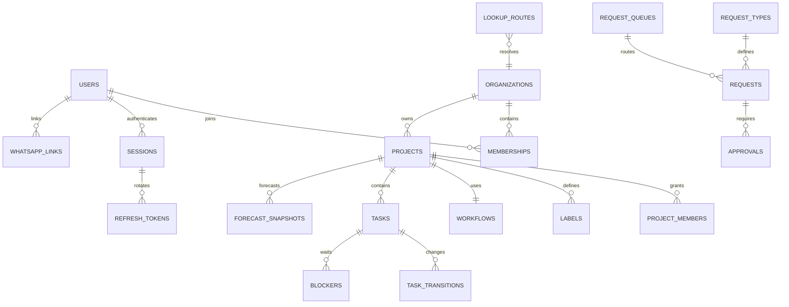

# Data model

Planned MongoDB collections. Every document has _id, createdAt, and updatedAt. Tenant rows have immutable organizationId (shown as org in index shorthand). Users, sessions, refreshTokens, oauthIdentities, authTokens, organizations, plans, lookupRoutes, authAuditLogs, and systemAuditLogs are global or pre-tenant records; a global lookup only resolves a candidate tenant and never grants access. Ordinary repositories always add organizationId and, for soft-deletable collections, the matching default filter `{ deletedAt: { $type: "null" } }`.

Index shorthand: U(fields) is unique; I(fields) is non-unique; T(field) is a single-field TTL index. Every soft-deletable row has explicit `deletedAt: null` at creation; deletion sets it to a timestamp. For those rows, U is a **partial unique** index with `partialFilterExpression: { deletedAt: { $type: "null" } }`; other unique indexes apply to all rows unless explicitly qualified. Repositories use the same `{ deletedAt: { $type: "null" } }` default filter, including on reads and updates, and explicitly opt into deleted rows only for authorized restore/purge flows. A missing-`deletedAt` expression is unsupported as a partial index filter. Index migrations, not request handlers, create indexes. Retention and system-scan exceptions appear below.

## Pre-tenant lookups

A pre-tenant resolver handles only the following global routes before a session or tenant exists. It verifies the result, establishes an organization context, and then calls a tenant repository. Request body or query organizationId is never authority.

| Input                       | Global route                                                           | Tenant verification                                                                                      |
| --------------------------- | ---------------------------------------------------------------------- | -------------------------------------------------------------------------------------------------------- |
| Refresh/session token       | Global refreshTokens by tokenHmac → sessions with activeOrganizationId | Phase 3a rechecks token family, session, and revocation; Phase 4 adds membership checks and switching    |
| Invitation or API key       | Opaque globally unique tokenPrefix in lookupRoutes → org and target ID | Load invitation/apiKeys by (org, ID); constant-time compare HMAC of full token, expiry, scope and status |
| WhatsApp webhook            | Verified Meta business phone number ID → lookupRoutes                  | Select configured org, then match sender phoneLookupHmac in that org's whatsappLinks                     |
| Billing webhook             | Verified provider customer ID → lookupRoutes                           | Load subscription by org and provider ID; process one idempotent event                                   |
| Inbound email               | Destination address lookup HMAC → lookupRoutes                         | Resolve integration and authenticate sender/command before creating work                                 |
| Public request form         | Host + normalized public form slug → lookupRoutes                      | Load active requestType and its public form settings; apply spam and rate controls                       |
| Phone account recovery/link | Global phoneLookupHmac → one or more lookupRoutes                      | Verify OTP and identity; never choose a tenant from a phone match alone                                  |

lookupRoutes has kind, provider/host, tokenPrefix or lookupHmac or publicSlug, organizationId, targetId, state, expiresAt, and keyVersion. Token prefixes are routing hints, not credentials. Generate bearer tokens from at least 32 CSPRNG bytes (256 bits); reserve at least the first 16 base64url characters of independent random token material as tokenPrefix (at least 96 bits). Reject prefix collisions and never treat a prefix alone as authentication. Use U(kind,tokenPrefix) for tokens; U(kind,provider,lookupHmac) for business phone number IDs, billing customers, and inbound addresses; U(kind,host,publicSlug) for forms, each partial on state=active. Personal phone mappings deliberately permit several orgs: I(kind,lookupHmac) plus U(kind,lookupHmac,organizationId,targetId). Expired or revoked mappings are never accepted, even before cleanup.

**WhatsApp multi-org rule:** one staff phone may link to several organizations. A dedicated Meta business phone number ID maps to exactly one organization, so inbound messages use that ID first and then the sender's org-scoped phone HMAC. If a Meta number is shared across organizations or the verified sender matches multiple accounts, require an explicit signed organization choice and reconfirm permissions before any read or write; do not silently select the first match. Consent and outbound routing remain per organization.

Normalize email addresses and E.164 phone numbers before HMAC-SHA-256 lookups. Hold one high-entropy master secret per key version in server-only secret storage; derive independent HMAC and authenticated-encryption keys with HKDF using distinct purpose labels and environment context. Store `keyVersion` beside every HMAC lookup field, token HMAC, and encrypted value so reads can select the correct version during rotation. Include org in tenant-only lookup inputs and use a separate global lookup purpose where cross-tenant routing is required. Store emailEncrypted and phoneEncrypted with authenticated encryption for authorized display; do not use reversible ciphertext as a search key. Never log raw values, lookup HMACs, tokens, or decrypted data.

## Identity, organization, and work

| Collection                      | Key fields                                                                                                                                                                                                                                                                                 | Planned indexes                                                                      |
| ------------------------------- | ------------------------------------------------------------------------------------------------------------------------------------------------------------------------------------------------------------------------------------------------------------------------------------------ | ------------------------------------------------------------------------------------ |
| users (global)                  | emailLookupHmac, emailEncrypted, keyVersion, displayName, passwordHash, status (pending/active/disabled), verifiedAt, deletedAt; 3b adds encrypted TOTP secret and recovery-code hashes                                                                                                    | U(emailLookupHmac) partial on deletedAt null; I(status,verifiedAt)                   |
| sessions (global)               | userId, activeOrganizationId (null in 3a), currentRefreshTokenId, familyId, deviceLabel, createdIpHmac, keyVersion, lastSeenAt, idleExpiresAt, expiresAt, revokedAt                                                                                                                        | I(userId,revokedAt,lastSeenAt); I(familyId); T(expiresAt)                            |
| refreshTokens (global)          | sessionId, userId, familyId, tokenHmac, keyVersion, issuedAt, expiresAt, usedAt, revokedAt, successorTokenId, purgeAfter                                                                                                                                                                   | U(tokenHmac); I(familyId,usedAt); I(sessionId,issuedAt); T(purgeAfter)               |
| oauthIdentities (global, later) | userId, provider, providerSubjectHmac, profileEncrypted                                                                                                                                                                                                                                    | U(provider,providerSubjectHmac); I(userId)                                           |
| authTokens (global)             | userId, purpose, tokenPrefix, tokenHmac, keyVersion, expiresAt, consumedAt; verify_email is live in 3a, password reset and MFA purposes wait for 3b                                                                                                                                        | U(tokenHmac); U(purpose,tokenPrefix); I(userId,purpose,consumedAt); T(expiresAt)     |
| authAuditLogs (global)          | userId, event, outcome, requestId, ipHmac, keyVersion, occurredAt, purgeAfter                                                                                                                                                                                                              | I(userId,occurredAt); I(event,occurredAt); T(purgeAfter)                             |
| organizations (root)            | slug, name, ownerId, settings, retentionPolicy, deletedAt                                                                                                                                                                                                                                  | U(slug); I(ownerId)                                                                  |
| memberships                     | userId, roleId, status, joinedAt, scopeGrants                                                                                                                                                                                                                                              | U(org,userId); I(org,status,roleId)                                                  |
| roles                           | name, builtIn, rank, permissionKeys, scopeLimit, createdBy                                                                                                                                                                                                                                 | U(org,name); I(org,rank)                                                             |
| invitations                     | emailLookupHmac, emailEncrypted, roleId, tokenPrefix, tokenHmac, expiresAt, acceptedAt, state                                                                                                                                                                                              | U(org,tokenPrefix); I(org,emailLookupHmac,state); T(expiresAt)                       |
| departments                     | name, managerId, status, deletedAt                                                                                                                                                                                                                                                         | U(org,name); I(org,managerId)                                                        |
| teams                           | departmentId, name, leadId, memberIds, deletedAt                                                                                                                                                                                                                                           | U(org,departmentId,name); I(org,leadId)                                              |
| leave                           | userId, startAt, endAt, status, approvedBy                                                                                                                                                                                                                                                 | I(org,userId,startAt); I(org,status,startAt)                                         |
| projects                        | key, name, visibility, ownerId, status, deletedAt                                                                                                                                                                                                                                          | U(org,key); I(org,status,updatedAt)                                                  |
| projectMembers                  | projectId, userId, projectRole, status, addedAt, addedBy                                                                                                                                                                                                                                   | U(org,projectId,userId); I(org,userId,status); I(org,projectId,projectRole)          |
| labels                          | projectId, name, color, deletedAt                                                                                                                                                                                                                                                          | U(org,projectId,name); I(org,projectId)                                              |
| projectTemplates                | name, workflowDefinition, taskBlueprints, deletedAt                                                                                                                                                                                                                                        | U(org,name)                                                                          |
| workflows                       | projectId, statuses, transitions, version                                                                                                                                                                                                                                                  | U(org,projectId)                                                                     |
| sprints                         | projectId, name, startAt, endAt, status                                                                                                                                                                                                                                                    | I(org,projectId,startAt)                                                             |
| sprintSnapshots                 | sprintId, capturedAt, scopeVersion, committedPoints, completedPoints, remainingPoints                                                                                                                                                                                                      | U(org,sprintId,capturedAt)                                                           |
| milestones                      | projectId, name, dueAt, status                                                                                                                                                                                                                                                             | I(org,projectId,dueAt)                                                               |
| goals                           | projectId, ownerId, target, progress, dueAt                                                                                                                                                                                                                                                | I(org,projectId,dueAt)                                                               |
| tasks                           | projectId, parentTaskId, title, descriptionRef, statusId, assigneeIds, watcherIds, reporterId, priority, labelIds, checklist, storyPoints, estimateMinutes, startAt, dueAt, rank, customFieldValues, recurrenceRule, nextCheckAt, scanEnabled, claimedUntil, claimedBy, version, deletedAt | I(org,projectId,statusId,rank); I(org,assigneeIds,dueAt); I(org,projectId,updatedAt) |
| taskTransitions                 | taskId, fromStatusId, toStatusId, actorId, occurredAt, durationMinutes, version                                                                                                                                                                                                            | I(org,taskId,occurredAt)                                                             |
| taskDependencies                | blockingTaskId, blockedTaskId, type                                                                                                                                                                                                                                                        | U(org,blockingTaskId,blockedTaskId); I(org,blockedTaskId)                            |
| taskTemplates                   | projectId, name, taskBlueprint, deletedAt                                                                                                                                                                                                                                                  | U(org,projectId,name)                                                                |
| comments                        | subjectType, subjectId, authorId, body, mentionedUserIds, visibility (internal/public), deletedAt                                                                                                                                                                                          | I(org,subjectType,subjectId,visibility,createdAt)                                    |
| discussions                     | projectId, title, authorId, status, lastActivityAt                                                                                                                                                                                                                                         | I(org,projectId,lastActivityAt)                                                      |
| attachments                     | subjectType, subjectId, ownerId, storageKey, contentType, size                                                                                                                                                                                                                             | I(org,subjectType,subjectId,createdAt); U(org,storageKey)                            |
| timeEntries                     | taskId, userId, startAt, durationMinutes, rateCardId, approvedAt                                                                                                                                                                                                                           | I(org,taskId,startAt); I(org,userId,startAt)                                         |
| rateCards                       | userId/teamId, currency, hourlyAmountEncrypted, effectiveAt, endAt                                                                                                                                                                                                                         | I(org,userId,effectiveAt); I(org,teamId,effectiveAt)                                 |
| projectDocs                     | projectId, authorId, title, contentRef, visibility                                                                                                                                                                                                                                         | I(org,projectId,updatedAt)                                                           |
| shares                          | subjectType, subjectId, principalType, principalId, permissionKeys, expiresAt, revokedAt                                                                                                                                                                                                   | I(org,subjectType,subjectId); I(org,principalType,principalId)                       |
| savedFilters                    | ownerId, name, queryDefinition, visibility                                                                                                                                                                                                                                                 | I(org,ownerId,name)                                                                  |
| customFieldDefinitions          | projectId, name, type, validation, deletedAt                                                                                                                                                                                                                                               | U(org,projectId,name)                                                                |
| activityLogs                    | actorId, subjectType, subjectId, eventId, occurredAt, purgeAfter                                                                                                                                                                                                                           | I(org,subjectType,subjectId,occurredAt); T(purgeAfter)                               |

Polymorphic comments belong to tasks, requests, discussions, or project docs. External readers see only public comments on an explicitly shared subject; internal comments remain hidden even if the subject is shared. Task dependency cycle checks and transition validity live in services, with taskTransitions recording each accepted state change.

Refresh uses a single-use token: atomically mark the presented `refreshTokens` row `usedAt`, insert its successor, and advance `sessions.currentRefreshTokenId`. Keep used token HMACs through the family's replay window. Reuse of any used token, including a concurrently presented predecessor, revokes the **entire family**, invalidates its session, and requires a fresh login. Failed or expired token lookup never creates a new session. Concurrent rotation must serialize on the session or use a compare-and-swap so one predecessor cannot mint two valid successors.

## Signature features

| Collection         | Key fields                                                                                                                                                                                                        | Planned indexes                                                                    |
| ------------------ | ----------------------------------------------------------------------------------------------------------------------------------------------------------------------------------------------------------------- | ---------------------------------------------------------------------------------- |
| blockers           | taskId, type, waitingOnType, waitingOnId, reason, since, expectedAt, slaDueAt, nextCheckAt, scanEnabled, claimedUntil, claimedBy, status, firedSteps, resolvedAt, resolvedById, resolution                        | I(org,taskId,status); I(org,waitingOnType,waitingOnId,status)                      |
| escalationPolicies | projectId, steps, slaMinutes, preventTaskCompletion                                                                                                                                                               | U(org,projectId)                                                                   |
| requestTypes       | name, formSchema, routingRules, approvalDefinition, slaPolicyId, publicFormSlug, deletedAt                                                                                                                        | U(org,name); U(org,publicFormSlug) when publicFormSlug exists                      |
| requestQueues      | name, departmentId, handlerIds, routingRules, status, deletedAt                                                                                                                                                   | U(org,name); I(org,departmentId,status); I(org,handlerIds,status)                  |
| requests           | typeId, requesterId, assigneeId, queueId, taskId, formValues, status, firstRespondedAt, responseDueAt, resolutionDueAt, pausedIntervals, nextCheckAt, scanEnabled, claimedUntil, claimedBy, csatRating, deletedAt | I(org,status,resolutionDueAt); I(org,requesterId,createdAt); I(org,queueId,status) |
| approvals          | requestId, step, approverId, delegatedTo, status, decidedAt                                                                                                                                                       | U(org,requestId,step,approverId); I(org,approverId,status)                         |
| slaPolicies        | requestTypeId, responseMinutes, resolutionMinutes, calendarId, pauseRules                                                                                                                                         | U(org,requestTypeId)                                                               |
| businessCalendars  | name, timezone, workingHours, holidays                                                                                                                                                                            | U(org,name)                                                                        |
| forecastSnapshots  | projectId, runId, seed, percentiles, confidence, riskDrivers, createdAt                                                                                                                                           | U(org,runId); I(org,projectId,createdAt)                                           |
| whatsappLinks      | userId, phoneLookupHmac, phoneEncrypted, optInAt, optOutAt, verifiedAt                                                                                                                                            | U(org,userId); U(org,phoneLookupHmac)                                              |
| whatsappMessages   | providerMessageId, linkId, direction, commandType, status, receivedAt, nextCheckAt, scanEnabled, claimedUntil, claimedBy                                                                                          | U(org,providerMessageId) when present; I(org,linkId,receivedAt)                    |

## Operations and SaaS

| Collection               | Key fields                                                                                                     | Planned indexes                                                                     |
| ------------------------ | -------------------------------------------------------------------------------------------------------------- | ----------------------------------------------------------------------------------- |
| notifications            | recipientId, eventId, type, readAt, createdAt, purgeAfter                                                      | U(org,recipientId,eventId,type); I(org,recipientId,readAt,createdAt); T(purgeAfter) |
| notificationPreferences  | userId, channels, digestSchedule, nextCheckAt, scanEnabled, claimedUntil, claimedBy                            | U(org,userId)                                                                       |
| automationRules          | name, trigger, conditions, actions, enabled, runCount                                                          | I(org,trigger,enabled)                                                              |
| automationRuns           | ruleId, eventId, depth, status, attempts, nextCheckAt, scanEnabled, claimedUntil, claimedBy                    | U(org,ruleId,eventId); I(org,status,createdAt)                                      |
| webhooks                 | endpointEncrypted, secretRef, eventTypes, enabled                                                              | I(org,enabled)                                                                      |
| webhookDeliveries        | webhookId, eventId, status, attempts, nextCheckAt, scanEnabled, claimedUntil, claimedBy, lastResponseCode      | U(org,webhookId,eventId); I(org,status,createdAt)                                   |
| webhookReceipts          | provider, providerEventId, processedAt, status, purgeAfter                                                     | U(org,provider,providerEventId)                                                     |
| apiKeys                  | ownerId, tokenPrefix, tokenHmac, scopes, createdBy, lastUsedAt, revokedAt                                      | U(org,tokenPrefix); I(org,ownerId,revokedAt)                                        |
| integrations             | provider, encryptedConfigRef, inboundAddressEncrypted, businessPhoneNumberIdEncrypted, status                  | U(org,provider)                                                                     |
| auditLogs                | actorId, systemRunId, action, reason, subjectType, subjectId, occurredAt                                       | I(org,occurredAt); I(org,subjectType,subjectId,occurredAt)                          |
| systemAuditLogs (global) | systemRunId, purpose, reason, collection, batchCap, scannedCount, occurredAt                                   | I(systemRunId,occurredAt); I(occurredAt)                                            |
| plans (global)           | key, seatLimit, featureLimits, priceRefs                                                                       | U(key)                                                                              |
| subscriptions            | provider, providerSubscriptionId, providerCustomerIdEncrypted, planId, status, currentPeriodEnd                | U(org,provider,providerSubscriptionId); I(org,status)                               |
| usageCounters            | period, metric, count                                                                                          | U(org,period,metric)                                                                |
| outboxEvents             | eventId, type, subjectId, payloadRef, publishedAt, nextCheckAt, scanEnabled, claimedUntil, claimedBy           | U(org,eventId); I(org,publishedAt,createdAt)                                        |
| jobReceipts              | jobType, idempotencyKey, status, completedAt, purgeAfter                                                       | U(org,jobType,idempotencyKey)                                                       |
| exports                  | requesterId, type, status, storageKey, expiresAt, nextCheckAt, scanEnabled, claimedUntil, claimedBy            | I(org,requesterId,createdAt); I(org,status,createdAt)                               |
| reportSchedules          | ownerId, reportType, timezone, schedule, nextCheckAt, scanEnabled, claimedUntil, claimedBy                     | I(org,ownerId,nextCheckAt)                                                          |
| importJobs               | requesterId, type, status, storageKey, progress, nextCheckAt, scanEnabled, claimedUntil, claimedBy             | I(org,requesterId,createdAt); I(org,status,createdAt)                               |
| lookupRoutes (global)    | kind, provider/host, tokenPrefix/lookupHmac/publicSlug, organizationId, targetId, state, keyVersion, expiresAt | Global indexes specified in Pre-tenant lookups; T(expiresAt) for temporary routes   |

## System-scope cron indexes and access

Normal tenant indexes start with org. The **only cross-tenant exceptions** are pre-tenant global resolution indexes and explicit system-scope scan indexes. For blockers, requests, recurring tasks, whatsappMessages awaiting retry, notificationPreferences, automationRuns, webhookDeliveries, outboxEvents, exports, reportSchedules, and importJobs, add a system index on (nextCheckAt, _id), `partialFilterExpression: { scanEnabled: true, nextCheckAt: { $exists: true } }`; for soft-deletable tasks and requests, also include `deletedAt: { $type: "null" }` in that partial expression. Each listed collection has `claimedUntil` and `claimedBy`. Each scan queries `scanEnabled: true`, `nextCheckAt <= now`, any matching `deletedAt: { $type: "null" }` predicate, and an expired or absent lease, with stable _id tie-breaker and bounded limit. Claim one record atomically only if its lease is absent/expired; set `claimedUntil` and `claimedBy`, then recheck in tenant context. Release or extend the lease after each bounded attempt; handlers remain idempotent. Keep nextCheckAt current after every state transition and clear scanEnabled on terminal records.

Only an authenticated scheduler or signed job may create an audited SystemContext containing systemRunId, purpose, allowed collection, time window, batch cap, and reason. A separate system repository method can query the partial scan index without org, writes a global systemAuditLogs record, and returns only (organizationId, recordId) and minimal scheduling fields. It then enters the normal tenant repository with that organizationId, revalidates the record before mutation, and writes a tenant audit record for any change. Public handlers, API keys, and user-selected roles cannot construct SystemContext or call the system scan method.

## Atlas dev index migration check

Before deploying an index migration, backfill `deletedAt: null` on every existing active row in each soft-deletable collection, preserve deletion timestamps on deleted rows, and check for duplicate active keys. On **Atlas dev**, the eventual migrations create **every** planned soft-delete partial unique index with `{ deletedAt: { $type: "null" } }` (including organizations, departments, teams, projects, projectTemplates, labels, taskTemplates, customFieldDefinitions, requestTypes, requestQueues, and any other U index on a soft-deletable collection). For **each** such index, it checks `getIndexes()` for the exact keys, uniqueness, and filter; runs an active-key lookup with `{ deletedAt: { $type: "null" } }` through `explain("executionStats")` to confirm the expected named index is selected; and tests that an active duplicate fails while reuse after soft deletion succeeds. Record each result in the migration/PR notes. Do not drop an old index until the replacement is verified and rollback is prepared. This is a required future migration check, not a claim that it has run.

## Retention, TTL, and search

- T(expiresAt) with expireAfterSeconds=0 applies to global sessions/authTokens and invitations; temporary lookupRoutes expire too. `refreshTokens` instead use T(purgeAfter), with `purgeAfter` later than family expiry and the replay/abuse investigation window, so used-token HMACs remain available for reuse detection. The application checks expiry and revocation itself because TTL deletion is asynchronous.
- Terminal outboxEvents, jobReceipts, webhookReceipts, webhookDeliveries, automationRuns, exports, and importJobs receive purgeAfter only after their idempotency/retry window; a single-field T(purgeAfter) removes eligible records. Do not set purgeAfter during a legal hold or unfinished retry. Choose the window longer than provider replay and audit needs.
- Notifications default to 180 days from creation or 30 days after read, whichever is later; set `purgeAfter` when eligible and use T(purgeAfter). Unread notifications still expire after 180 days. ActivityLogs default to 365 days from `occurredAt` with T(purgeAfter). Organization retention may extend these periods; placing a legal hold must remove `purgeAfter` before TTL can act, and held rows get no new `purgeAfter`. Audit logs are separate and never inherit the shorter activityLogs policy.
- Global authAuditLogs default to 365 days. Tenant and system audit logs, billing records, and customer work follow organization retention and legal-hold rules. Soft deletion is reversible until a bounded purge job deletes related records and object-storage files; a TTL index alone must not remove them. Minimize WhatsApp content and apply a short configurable retention period.
- Phase 6 search starts with tenant-filtered, indexed task/request metadata and capped pagination. Evaluate Atlas Search with an organizationId filter and visibility checks when the selected Atlas tier supports it; otherwise use tenant-constrained MongoDB text indexes on searchable, non-encrypted fields. Never index decrypted PII or search across tenants. Validate relevance and explain plans on realistic data before launch.

Partial unique indexes on active records permit reuse after soft deletion, while system partial indexes exclude inactive work. MongoDB TTL is eventually applied, so every resolver checks dates before trusting a row. See the [MongoDB partial index](https://www.mongodb.com/docs/manual/core/index-partial/) and [TTL index](https://www.mongodb.com/docs/manual/core/index-ttl/) documentation for index semantics.

## Phase 3b global auth data

- `users` gains `credentialVersion`, encrypted active and pending TOTP secrets with separate HKDF purposes and key versions, pending expiry/session ID/attempt count, `mfaEnabledAt`, `mfaLastUsedStep`, and ten versioned recovery-code HMACs. TOTP and recovery fields are read by user `_id`; no secret index is needed. The active secret is 160 CSPRNG bits. Recovery codes are 80 bits each, encoded as 16 base32 characters and formatted `XXXX-XXXX-XXXX-XXXX`.
- `authTokens` adds `password_reset` (one hour) and `mfa_login` (five minutes) purposes, plus challenge attempt count, invalidation time, and credential version. Reuse unique HMAC and purpose/prefix indexes, `I(userId,purpose,consumedAt)` and `T(expiresAt)`. Queries check dates because TTL is asynchronous. Issuing a reset consumes older reset tokens; challenge attempts increment atomically before factor verification.
- `sessions.mfaVerifiedAt` records second-factor completion when the session was created through a challenge. Password reset revokes all sessions and refresh families; password change revokes all except the initiating session.
- `authNotificationOutbox` is global: `userId`, template name, state, `nextCheckAt`, `claimedUntil`, `claimedBy`, `purgeAfter`. `P(state,nextCheckAt,claimedUntil)` for pending records and `T(purgeAfter)` retain a sent record for 30 days. No token, code, URI or message body is stored. Delivery starts after commit; retry sweep depends on the pending scheduler decision. Reset-link mail is sent directly from the `waitUntil` task and cannot be reconstructed from this outbox.
